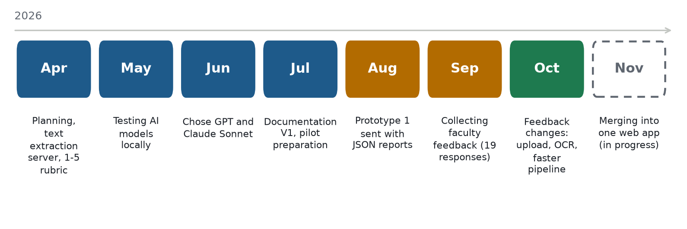
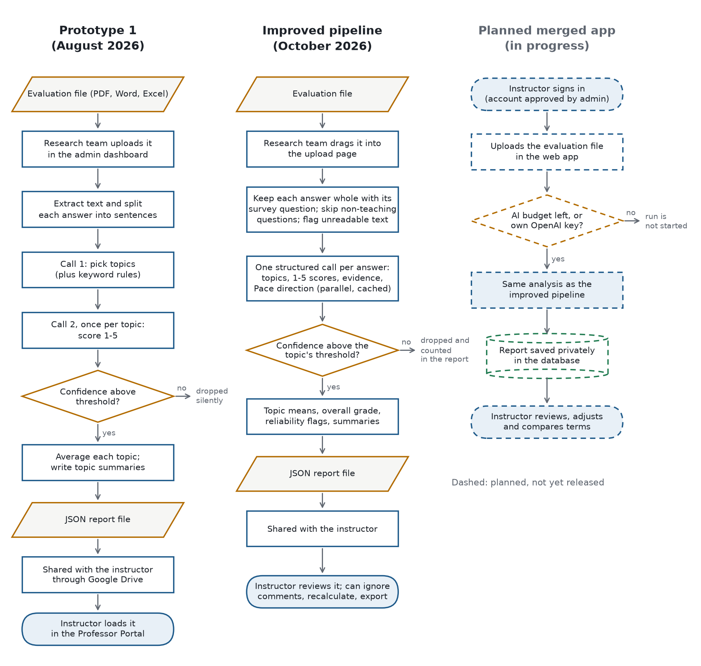
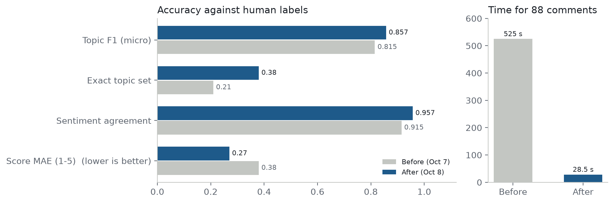
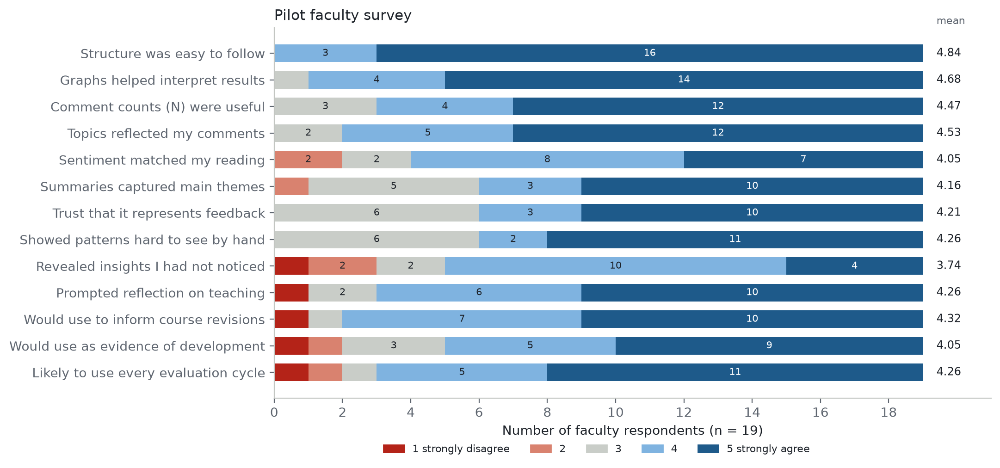
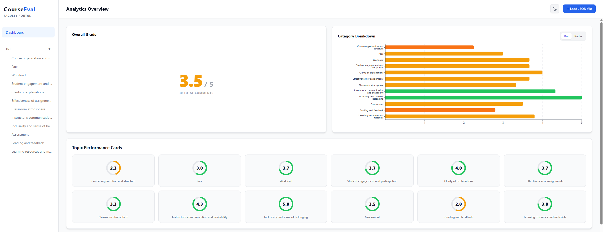
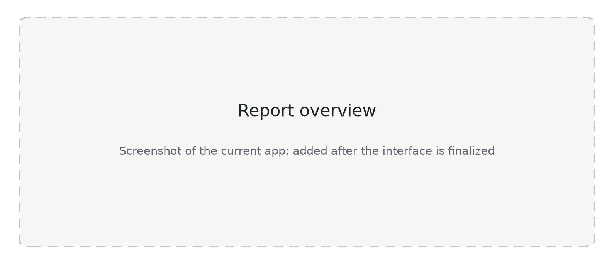
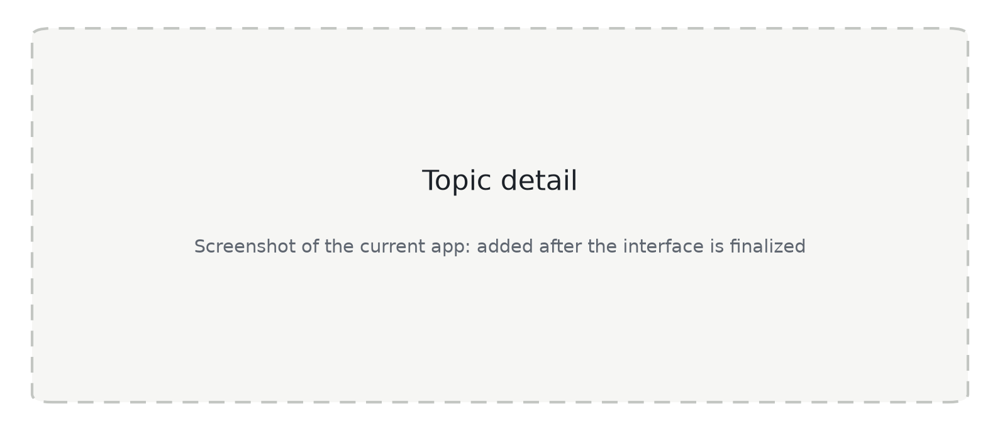
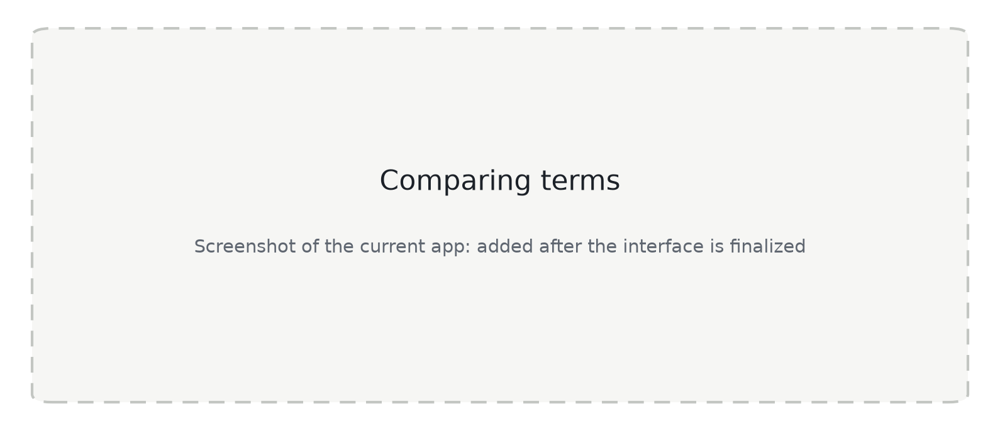

# Course Evaluation Analytics Platform: Documentation V2

**Project history, design and results, from the first prototype to the web app in development**

| | |
|---|---|
| Version | 2.0, November 2026. Replaces Documentation V1, July 16, 2026 |
| Author | Harsh Amberkar, California State University, Monterey Bay |
| Pilot portal | `https://secotterlab.org/course-eval/` |
| Source code | `github.com/amberkar-harsh-02/Course-Evaluation-Dashboard` |
| Status | Prototype 1 piloted with faculty (August to September 2026) and improved from their feedback (October 2026). A merged web application is in development. |

> **How to read this document.** Sections 1, 5 and 6 update the three chapters of Documentation V1 (product overview,
> pipeline pillars, dashboard metrics) so they describe the system as it works today. Sections 2 to 4 and 7 to 10 are
> new: the timeline, what changed and why, the measured results, the website, the evaluation method, privacy, and
> what comes next. Measured results cite the file they come from.

## Abstract

Open-ended comments in end-of-term course evaluations are the richest feedback instructors receive, and the hardest to
use: a class of a hundred students produces hundreds of loosely structured remarks that are slow to read and easy to
misjudge. This project built a system that reads an evaluation export, assigns each student answer to one or more of
twelve teaching topics, scores it from 1 to 5 against a topic-specific rubric, and presents the results to the
instructor as an interactive report. Over 2026 the project compared language models run locally, chose hosted models,
and sent a first prototype to faculty in August. Nineteen survey responses rated it highly for ease of use (mean 4.84
of 5) and well for trust in the analysis (4.21). Their feedback led to an improved pipeline in October: keeping each answer whole,
giving the model the survey question, and asking for topics and scores in one structured call raised topic agreement
with human labels from F1 0.815 to 0.857, lowered the score error from 0.38 to 0.27 points on the 1 to 5 scale, and
cut processing time for the 88-comment benchmark from 525 s to 28.5 s. The analysis pipeline and the faculty portal
are now being merged into one self-service web application.

## 1. Product overview

### What the platform is

The Course Evaluation Analytics Platform reads raw, unstructured student course evaluations and turns them into a
report an instructor can explore. Instead of scrolling through hundreds of comments at the end of a term, the instructor
sees what each comment is about, how positive or negative it is, a short written takeaway for every teaching topic, and
a note whenever a topic rests on too few comments to rely on.

### Who it is for

- **Instructors**, who want a fast and trustworthy summary of what students said, without losing the individual
  comments behind each number, so they can see what is working and what to change.
- **The research team and administrators**, who run the analyses today and need a consistent view of feedback across
  courses without hand-coding open-ended responses.

### What problem it solves

A single comment can touch several topics, contradict itself, or say almost nothing ("Labs", "None"). Sorting and
weighing such feedback by hand is slow and inconsistent. The platform:

- reads every answer whole, together with the survey question it responds to;
- separates multi-topic answers so mixed feedback does not blur together;
- scores each topic against a fixed rubric instead of an impressionistic skim;
- flags when the evidence behind a score is too thin to act on;
- delivers the result as an interactive report rather than a static spreadsheet.

### The technology today

| Layer | What it is |
|---|---|
| Text extraction ("OCR") server | Python, FastAPI. Reads PDF, Excel, CSV and Word exports and returns each student answer whole with its question, plus the multiple-choice rating tables. |
| Analysis pipeline | Python. One structured call per answer to a hosted model (OpenAI `gpt-5.6-terra` by default), or to a local Qwen model on the lab Mac Studio for the research team. Parallel and cached. |
| Admin dashboard | React. The research team uploads evaluation files, runs the analysis and downloads the reports. |
| Professor Portal | React. Instructors open their report to see scores, charts, topic summaries and comments, ignore comments that do not apply, and export the result. |
| In development | One merged web application in which instructors sign in, upload their own files and keep their reports (Section 3.2). |

## 2. Project timeline

*Figure 1. The project month by month.*

| When (2026) | Phase | What happened |
|---|---|---|
| April | Planning and text extraction | Architecture, data format and themes planned. April 13: first version of the text extraction server (FastAPI, Word and PDF). April 23: rubric meeting; the scale moved from 0 to 4 to **1 to 5** so a high score always means positive and no instructor sees a zero, Pace and Workload were separated, and themes were merged or split into the final **12 topics**. |
| May | Testing AI models locally | Local language models and classifiers were run and compared against human labels: Llama3, Gemma 3, Qwen, RoBERTa-large-MNLI and DistilRoBERTa (Section 4.1). |
| June | Choosing the models | June 12: methodology guide (normalization, retrieval of similar human-graded examples, evidence-based topic classification, rubric scoring, quote grounding, summaries). After trials on real evaluation files, the hosted models **GPT (`gpt-5.6-terra`)** and **Claude Sonnet** were chosen; local Qwen stayed available for the research team. June 24: first platform manual. |
| July | Documentation V1 and pilot preparation | July 16: **Documentation V1** (five engineering pillars, two prompts per comment, confidence thresholds). Reports generated for the pilot instructors and the Professor Portal prepared. |
| August | Prototype 1 sent | **Prototype 1** went out: each pilot instructor received a JSON report through Google Drive and opened it in the Professor Portal, with a user manual and a feedback form. First responses on August 6. |
| September | Collecting feedback | Responses kept arriving until September 29: **19 in total** (Section 4.3). |
| October | Improving from the feedback | Interface changes requested by instructors, including **drag-and-drop upload**; "ignore comments" with score recalculation and JSON export in the portal. **Text extraction (OCR) fixed** and the **analysis pipeline improved** to cut the time to process a document: whole answers with their questions, one structured call per answer, parallel and cached calls, plus an evaluation harness and automated tests (Section 4.2). |
| November | Merging into one web app (in progress) | Work under way to merge the analysis pipeline and the portal into one application with instructor accounts, AI budgets and private reports (Section 3.2). Cost estimate for a year of use prepared (Section 4.4). Claude Sonnet dropped so that one provider handles cost tracking and personal API keys. |

## 3. What changed and why

*Figure 2. Flowchart of how an evaluation file becomes a report: in prototype 1 (left), with the improved pipeline of
October (middle), and in the merged app being developed (right, dashed). Parallelograms are files, rectangles are steps,
diamonds are decisions, rounded boxes are where a person starts or finishes, and the cylinder is the database.*

### 3.1 From V1's five pillars to the October pipeline

| V1 pillar (July 2026) | What it did in prototype 1 | What it does after October | Why it changed |
|---|---|---|---|
| 1. Configuration and rules | Local Qwen model or a hosted model; per-topic confidence thresholds (0.35 to 0.45); keyword hints that forced extra topics. | Hosted model by default with a provider-enforced JSON schema; local Qwen kept for the research team. Thresholds kept (Section 6). Keyword forcing **removed**. | Keyword rules added topics the model then had to reject. Schema enforcement removed malformed answers. |
| 2. Data preparation and RAG | Cleaned text; split answers into **sentences**; retrieved similar human-labelled examples. | Keeps each **answer whole** with its survey question; skips answers to questions about the student rather than the teaching; still retrieves examples (2 for topics, 1 for scoring) when the labelled files are present. | Splitting turned one answer into many "comments" (one file: 410 fragments for 123 real answers) and made fragments hard to interpret. Answers to non-teaching questions filled the "Other" bin (about 25 % of comments). |
| 3. Categorization engine (prompt 1) | One call to pick topics. | Merged into a single structured call. | Two calls per topic cost time and money and gave lower accuracy (Section 4.2). |
| 4. Scoring engine (prompt 2) | One more call per assigned topic. | The same call returns, per topic, a 1 to 5 score, confidence, evidence quote and, for Pace, the direction (too fast, too slow, about right). | As above. Pace previously used a non-monotonic code (1 = too fast, 2 = too slow, ...), so its average was meaningless; it now runs from 1 (serious problem) to 5 (well paced) with a separate direction. |
| 5. Main loop and export | Sequential calls; JSON and CSV export. | Up to 8 parallel calls (2 for the local model); answers cached so an unchanged re-run is free; every dropped result and model error is counted in the report. | A large file took up to 78 minutes; silent drops hid how much of a report rested on uncertain results. |

### 3.2 Where the project is heading: one web application (in progress)

Prototype 1 depended on the research team for every step. The merged application is being built so instructors can
do the whole process themselves. The table compares prototype 1 with the goals of the merge; none of these features
has been released yet.

| Prototype 1 | Goal of the merged app |
|---|---|
| The research team uploads each file and sends the instructor a JSON report through Google Drive. | Instructors sign in, upload their own file, follow its progress, and find the report in their account. |
| The instructor loads a file into the portal; reports are not stored. | Reports are stored on the server, and each one can be opened only by the account that created it. |
| No personal accounts. | Registration with administrator approval, password rules, and lock-out after repeated failed sign-ins. |
| All AI use on the lab's key, not tracked per person. | Every run records its tokens and cost. The administrator gives each instructor lab credit with a yearly dollar cap, lab credit without a cap, or the option to use their own OpenAI key, stored encrypted. |
| One report at a time. | Comparison of two or more reports of the same course across terms. |
| A separate PDF manual. | A built-in guide shown on first sign-in. |

## 4. Results

### 4.1 Choosing a model (May to June 2026)

The local comparison measured each approach against human labels. Topic classification was measured on the benchmark
comments that could be matched to the human-labelled file (27 of 29); sentiment scoring on 195 human-scored
comment-topic pairs.

| Model | Topic micro F1 | Topic macro F1 | Exact topic set | Score exact | Score within 1 | Score MAE |
|---|---|---|---|---|---|---|
| Llama3 (local LLM) | 55.6 % | 42.4 % | 14.8 % | 63.6 % | 91.8 % | 0.46 |
| Gemma 3 (local LLM) | 52.2 % | 45.4 % | 25.9 % | 53.3 % | 88.7 % | 0.59 |
| RoBERTa-large-MNLI | 35.8 % | 29.1 % | 0.0 % | 51.3 % | 86.7 % | 0.63 |
| DistilRoBERTa | 17.8 % | 15.6 % | 3.7 % | 59.0 % | 87.7 % | 0.62 |
| Always predict 5 (baseline) | | | | 63.6 % | 88.7 % | 0.53 |

*Source: `NLP/results/topic_model_comparison.csv` and `NLP/results/sentiment_model_comparison.csv`.*

Two findings shaped the next steps. First, zero-shot transformer classifiers could not assign the twelve topics
reliably, so the project committed to large language models; the trials on real files in June then led to the hosted
models. Second, course evaluations are skewed positive: a constant prediction of 5 already matches 63.6 % of human
scores, so exact-match accuracy alone is a weak measure. Later evaluations therefore also report the mean absolute
error (MAE) and agreement on positive or negative sentiment.

### 4.2 Improving the pipeline (October 2026)

The October work found that most errors came from what the model was given rather than from the model itself. After
the changes in Section 3.1 the pipeline was measured again on the same 88 human-labelled comments with the same model
(`gpt-5.6-terra`, retrieval examples on).

*Figure 3. Agreement with human labels and processing time before and after the pipeline improvements (measured October 7
and 8).*

| Measure (88 human-labelled comments) | Before | After |
|---|---|---|
| Topic micro F1 | 0.815 | 0.857 |
| Topic macro F1 | | 0.741 |
| Comments with exactly the right set of topics | 21 % | 38 % |
| Score MAE on the 1 to 5 scale | 0.38 | 0.27 |
| Scores within 1 point of the human score | | 100 % |
| Positive or negative agreement with humans | 91.5 % | 95.7 % |
| Time to process the 88 comments | 525 s | 28.5 s |

*Sources: `docs/Backend_Improvements_Report.pdf`; "after" details from
`NLP/eval_runs/20261008_131258_openai/summary.json` (prompt version 2026-10-08.4: topic metrics on 29 matched comments,
score metrics on 157 comment-topic pairs).*

Per-topic F1 with the improved pipeline ranged from 1.0 (communication and availability) and 0.96 (learning resources) down to
0.50 (inclusivity) and 0.0 (grading and feedback). With only 29 comments in the topic benchmark, the weakest topics rest
on very few labelled examples; a larger labelled set is a main item of future work (Section 10).

On three real files the improvements changed what reached the model and how long it took:

| File | Units sent to the model | Share left uncategorized | Processing time |
|---|---|---|---|
| Large spreadsheet export | 410 fragments, now 123 whole answers | 25 % to 5 % | 23.5 min to 52 s |
| PDF report | 34 to 50 answers | 24 % to 8 % | 97 s to 14 s |
| Converted Excel report | 32 fragments, now 16 answers | 9 % to 0 % | 118 s to 8 s |

*Source: `docs/Backend_Improvements_Report.pdf`.* Overall scores moved slightly (for example 3.62 to 3.97) because long
answers are no longer counted several times. Pace averages from prototype 1 are not comparable with later ones because
the Pace rubric was corrected.

### 4.3 What instructors said about prototype 1 (August to September 2026)

Pilot instructors completed a feedback form after receiving their report: 19 responses between August 6 and
September 29, 2026. Items used a 1 (strongly disagree) to 5 (strongly agree) scale.

*Figure 4. Responses to the prototype 1 feedback form (n = 19). Only aggregate counts are shown.*

- **Usability was rated highest.** The structure was easy to follow (mean 4.84), the graphs helped interpret the
  results (4.68) and the comment counts were useful (4.47).
- **Accuracy was rated well, with room to improve.** The topics reflected the comments (4.53); the summaries captured
  the main themes (4.16); the sentiment matched the instructor's own reading (4.05); and respondents trusted that the
  analysis represents their students' feedback (4.21). Fifteen of 19 called the tone of the analysis "about right",
  three "too critical" and one "too positive".
- **New insight was rated lowest.** "Revealed insights I had not noticed" averaged 3.74, the only item below 4. This
  suggests the tool mainly organizes and confirms what attentive instructors already sense, and its value lies in the
  time saved and the evidence it collects.
- **Intended use was strong.** Instructors would use it to inform course revisions (4.32) and after every evaluation
  cycle (4.26), and somewhat less as evidence of teaching effectiveness (4.05).

*Source: aggregate answer counts from the prototype 1 feedback form export (19 responses; not in the repository).*

The feedback set the October work: easier uploading (drag and drop), more reliable text extraction, faster processing,
the ability to leave out comments that do not apply and recalculate, and export. Requests that need accounts and
stored reports, such as comparing courses or terms, moved into the merged application.

### 4.4 Cost estimate for the merged app

For the merged application, where instructors will run their own analyses, a year of use was estimated from offline
prompt measurements: about 3,000 input tokens per answer (about 2,500 of them the fixed rubrics) and about 250 output
tokens. An average file has 186 answers, of which about 153 are analysed. At 250 files a year this comes to roughly
**$230 to $500** of OpenAI usage, depending on prompt caching and list price, so a typical file costs a few cents to
about a dollar. *Source: `docs/Phase0_Purchase_Estimate.pdf`.* The pipeline now records the tokens and cost of every
run, so the estimate can be replaced by measured figures once the app is in use.

## 5. How the analysis works now

This chapter replaces V1's "Core functional pillars" and describes the improved pipeline from October 2026.

### Step 1: Extraction

The extraction server reads PDF, Excel, CSV and Word exports. It keeps each student answer whole, joins lines that the
export had wrapped, records the survey question each answer responds to, and removes list bullets and stray encoding
characters. Survey boilerplate, rating rows and unreadable PDF text are filtered with rules and a small TF-IDF plus
linear SVM classifier. When a PDF's text is mostly not real words (some fonts store letters as symbols), the report
says so and asks for an Excel or CSV export instead of analysing gibberish. Multiple-choice rating tables in Excel and
CSV exports are read into their own section with counts, mean and full distribution; PDF rating tables are not read yet.

### Step 2: Preparation

Exact duplicate answers are removed. Answers to questions about the student rather than the teaching ("Did you feel
prepared by prior coursework?") go straight to "Other" without an AI call and are counted in the report.

### Step 3: One structured analysis per answer

Each answer is sent once, with its survey question, the twelve topic definitions and the 1 to 5 rubric. When the
human-labelled files are present, the most similar labelled examples are added for calibration. The provider enforces a
JSON schema, so the reply always parses. For every topic the answer actually discusses, the reply gives:

- the topic and the model's confidence;
- a 1 to 5 score on that topic's rubric;
- an evidence quote from the answer;
- for Pace, whether the course felt too fast, too slow or about right.

Generic comments with no specific topic ("Best professor ever!") receive a separate general-sentiment score instead.

The twelve topics are: course organization and structure; pace; workload; student engagement and participation;
clarity of explanations; effectiveness of assignments; classroom atmosphere; instructor's communication and
availability; inclusivity and sense of belonging; assessment; grading and feedback; learning resources and materials.

### Step 4: Filtering

A topic score is dropped when the model's confidence is below that topic's threshold: 0.45 for Assessment and
Workload, 0.40 for Pace and Course organization, 0.35 otherwise. Stricter topics need stronger evidence because their
vocabulary overlaps with others. Every drop and every model error is counted in the report rather than silently
discarded.

### Step 5: Aggregation and summaries

Topic averages, the overall score and reliability flags are computed (Section 6). A final call per topic writes a
one-sentence summary of what students said about it. Calls run in parallel and are cached, so re-running an unchanged
file costs nothing.

## 6. Dashboard metrics explained

This chapter replaces V1's chapter 3. What V1 said about averages and multi-topic answers still holds; the changes
are in how the overall grade is formed and in the reliability flags.

- **Topic score.** The mean of the valid 1 to 5 scores for that topic. Answers that mention a topic without evaluating
  it ("Labs") still appear on the topic for context but are not part of the average, so the number of comments on a
  topic and the number of scored comments can differ, by design.
- **Overall grade.** The mean, over answers, of each answer's average topic score. A long answer touching five topics
  counts once, like a short one, and cannot outweigh it.
- **General sentiment.** Generic praise or criticism is reported separately and never changes the overall grade.
- **Multi-topic answers.** Each topic gets its own independent score. "The pace was too fast, but the homework was
  great" produces a low Pace score and a high assignments score, not one muddled average.
- **Pace direction.** Alongside its score, Pace reports how many answers said too fast, too slow or about right.
- **Reliability flags.** Each topic carries one flag:
  - *reliable*: five or more scored comments and no warnings;
  - *low sample*: fewer than five scored comments, so read it as directional evidence only;
  - *mixed confidence*: some scores rest on low model confidence (below 0.35), so read the comments;
  - *needs review*: a model error was excluded;
  - *unscored*: no scored comments.
- **Ignoring comments.** An instructor can exclude comments that do not apply to a topic (for example, a remark about a
  different course). The topic and overall scores are recalculated with the same rules as the pipeline, and the
  excluded comments stay visible, marked as ignored.

## 7. The website: prototype 1, October changes and the app in development

*Figure 5. The Professor Portal in prototype 1: the instructor loaded the JSON report shared by the research team.
Shown above the comment list only; course identity removed.*

**Prototype 1 (August).** Instructors downloaded their JSON report from a shared Google Drive folder and loaded it
into the Professor Portal. The portal showed the overall grade, a category chart that switched between bar and radar,
a score card for each topic, a detailed view per topic with its comments and summary, and a filterable comment list.

**After the feedback (October).** Uploading moved to drag and drop; comments that do not apply can be ignored for a
topic, the scores recalculated, and the edited report exported; comment text is cleaned of stray symbols; and reports
arrive much faster because of the improved pipeline.

**The merged app (in development).** The goal is one site where instructors:

1. request an account and, once approved, are welcomed with a short guide;
2. upload an evaluation file and follow its progress;
3. read the report: overall grade, category chart, topic cards, a detail view per topic, and a searchable list of
   every analysed comment;
4. ignore comments and recalculate, and download the report;
5. compare two or more terms of the same course;
6. see the AI credit left for the year, or add their own OpenAI key.

Its interface is still changing, so the figures below are placeholders until it is finalized.

*Figure 6. Placeholder for the report overview in the merged app.*

*Figure 7. Placeholder for the topic detail view in the merged app.*

*Figure 8. Placeholder for comparing terms in the merged app.*

## 8. Evaluation method

- **Ground truth.** Two human-labelled files: topic assignments for benchmark comments
  (`HUMAN_CATEGORIZED_OUTPUT.csv`) and topic-level scores with reasoning (`HUMAN_SENTIMENT_BASELINE.csv`).
- **Topic metrics.** Micro and macro F1 over the twelve topics plus "Other", and the share of comments whose full topic
  set matches exactly.
- **Score metrics.** MAE on the 1 to 5 scale; share of exact and within-1 matches; agreement on positive (4 to 5) versus
  negative (1 to 2) sentiment; coverage (the share of human-scored pairs the model also scored).
- **Harness.** `NLP/eval.py` runs the pipeline on the labelled comments and writes a summary per run to `NLP/eval_runs/`.
  Every change in Section 3.1 was measured this way before it was kept.
- **Automated tests.** Tests for the analysis pipeline and its API use a fake model, so they cost nothing and never
  touch student data; the merged app is being built with its own test suite.
- **Limitations.** The labelled benchmark is small (88 comments; 29 for topic metrics) and comes from a small number of
  courses, so per-topic results for rare topics are unstable. The model is a commercial API whose behaviour can change
  between versions; each report records the model ID and prompt version. The pilot survey is self-reported by
  volunteers who had already received a report.

## 9. Privacy, security and data handling

**In place today**

- **Who runs analyses.** Only the research team uploads evaluation files and runs the analysis.
- **Server access.** The analysis server listens only on the local machine by default, accepts requests only from the
  admin dashboard and can require an access key. Uploaded file names are cleaned so they cannot reach other folders,
  and earlier reports are archived rather than overwritten.
- **Sharing.** Each instructor receives only their own report.
- **Student data in the repository.** None. Raw evaluations, generated reports, the human-labelled files and the
  model cache are excluded from version control. Figure 5 is cropped so no student text appears.
- **Third-party processing.** Comments are sent to the hosted model for analysis unless the local model is chosen.

**Being built into the merged app**

- Reports visible only to the account that created them.
- Instructor accounts with administrator approval, hashed passwords, password rules and lock-out after repeated
  failed sign-ins.
- Personal API keys encrypted at rest, shown only as their last four characters, and never logged.
- Per-instructor AI budgets, with every run's cost recorded.
- A database backed up nightly.

## 10. Lessons learned and next steps

**Lessons**

1. **Fix the input before tuning the model.** The largest accuracy gains came from keeping answers whole and passing
   the survey question, not from changing models.
2. **Measure before keeping a change.** A small labelled benchmark and a repeatable harness turned design debates into
   measurements.
3. **Fewer, structured calls beat more calls.** One schema-enforced call per answer was faster, cheaper and more
   accurate than separate classification and scoring calls.
4. **Make uncertainty visible.** Instructors trusted the reports more when thin evidence was flagged rather than hidden.
5. **Pilot early.** Prototype 1 showed what instructors valued (clarity, charts, comment counts) and what they needed
   next (easier upload, speed, control over comments, comparison across terms).

**Next steps**

- Finish, test and release the merged web application.
- Enlarge and diversify the labelled benchmark, especially for rare topics, and measure inter-rater agreement.
- Read rating tables from PDF exports.
- Move hosting to a managed cloud provider once funding is confirmed.
- Replace the cost estimate with measured cost per file.
- Study whether instructors change their courses after using the reports (the pilot measured intent only).

## Appendix A. Commit timeline

| Date (2026) | Change |
|---|---|
| April 13 | FastAPI text extraction server with Word support; PDF extraction and text sanitization |
| October 7 | Repository consolidated: extraction server, analysis pipeline and API, admin dashboard, Professor Portal; ignore-comments mode with recalculation and export |
| October 8 | Whole answers with questions and rating tables; single structured analysis, parallel calls, cache, background jobs, evaluation harness |
| October 28 | Bullet symbols removed from comments in the portal |
| November | Merged web application in development |

## Appendix B. Where things are

| Path | What it holds |
|---|---|
| `OCR/` | Text extraction server |
| `NLP/main.py`, `NLP/data.py` | Analysis pipeline; topic definitions and rubric |
| `NLP/eval.py`, `NLP/experiments.md` | Evaluation harness; model comparison runbook |
| `ProfessorPortal/`, `dashboard/` | Professor Portal and admin dashboard |
| `CourseEvalApp/` | Merged web application (in development) |
| `docs/documentation-v2/` | This document, its figures, and the LaTeX version for Overleaf |

## Appendix C. Glossary

- **F1 score.** Balance of precision (topics the model assigned that were right) and recall (right topics the model
  found). *Micro* pools all decisions; *macro* averages per topic, so rare topics count equally.
- **MAE.** Mean absolute error: the average distance between the model's score and the human score on the 1 to 5 scale.
- **RAG.** Retrieval-augmented generation: adding similar human-labelled examples to the prompt.
- **Structured output.** A reply the provider forces to follow a JSON schema, so it can always be read by the program.
- **Prompt caching.** The provider's discount for prompt text repeated exactly at the start of a request (here, the
  rubrics).
